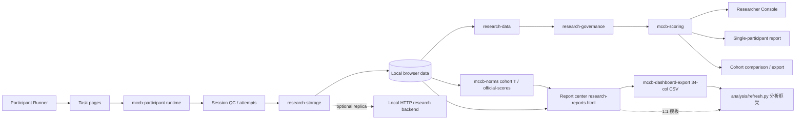
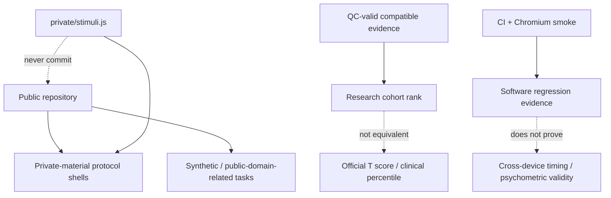

# Architecture

`psy-exp` is intentionally browser-first. The architecture separates task execution, research governance, local storage, optional replication, and researcher-facing interpretation.

## Result-processing stage (report center)

`research-reports.html` is the result-processing layer merged in from the `mccb-dashboard` workbench (2026-10): it re-renders the same three self-contained templates (cohort dashboard / per-file / per-person, byte-identical in `mccb-report-templates.js`) over browser-local data. Scoring inside the report center:

1. `mccb-norms.cohortTForVisits` — within-cohort reference T (T = 50 + 10·Φ⁻¹(rank/100), tied-rank pools, N≥5 per test pool; **research caliber, not MCCB norms**);
2. `mccb-official-scores` — optional official scoring T injection, **official takes priority**;
3. Kruskal-Wallis gender significance (self-contained JS implementation in `mccb-dashboard-export.js`, cross-validated against scipy in `analysis/refresh.py` by `tests/verify-export-csv.cjs`).

The exported 34-column CSV feeds `analysis/refresh.py` unchanged (per-record roundtrip asserted in CI), so the browser research workflow and the Python analysis framework share one schema.

## Trust and evidence boundaries

## Canonical control files

- `task-manifest.json` — task/runtime/material/scoring metadata.
- `protocol-lock.json` — protocol lock and governance state.
- `RESEARCH_VALIDATION.md` — what has and has not been validated.
- `docs/PROTOCOL_GOVERNANCE.md` — protocol change rules.
- `docs/RESEARCH_DATA_MODEL.md` — research data entities and versions.
- `docs/BACKEND_V1.md` — local-primary / optional HTTP-replica design.

## Runtime surfaces

- `index.html` — researcher console.
- `participant-runner.html` — participant flow and preflight.
- `pages/` — individual task implementations.
- `mccb-participant.js` — task runtime/session behavior.
- `mccb-scoring.js` — research-safe compatibility and ranking logic.
- `research-storage.js` / `research-data.js` / `research-governance.js` / `research-session.js` — research data pipeline.
- `research-report.html` / `research-comparison.html` — interpretation/export surfaces.
- `research-reports.html` — report center (result-processing stage): cohort overview + per-person reports, cohort reference T + official-score injection, 34-column CSV export.
- `mccb-norms.js` — cohort-t reference T (cohort-t-0.1.0, research caliber).
- `mccb-official-scores.js` — official scoring T injection store (official-scores-v1).
- `mccb-dashboard-export.js` — shared row builder / CSV export / KW implementation.
- `analysis/` — cleaned `refresh.py` framework + template extractor (demo `DIAG_MAP` only).
- `demo/` — 100%-synthetic demo site (seed 20261028).
- `server/research-backend.cjs` — optional local HTTP replica.

## Validation boundary

The architecture is executable enough to be regression-tested, but software architecture evidence must not be converted into a psychometric-equivalence claim.
